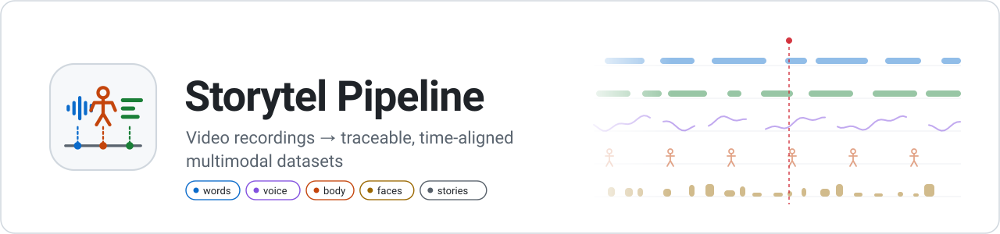
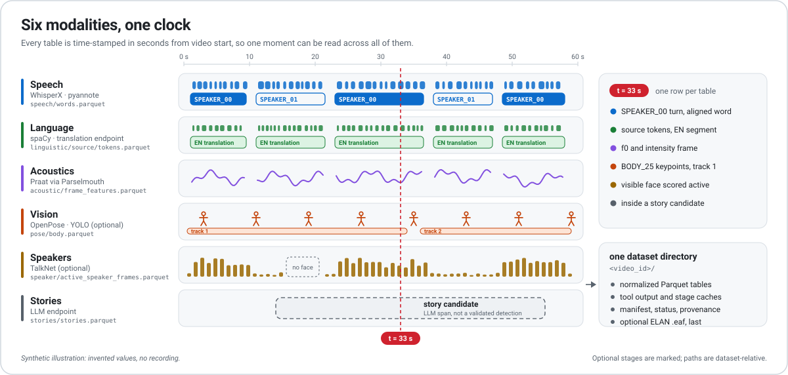
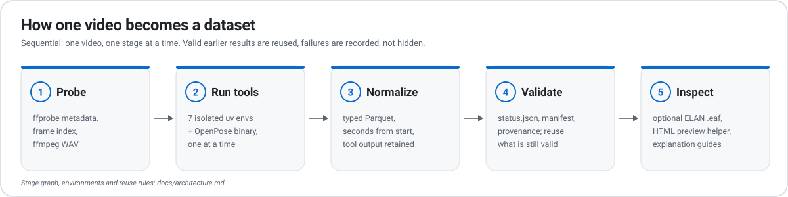

# Storytel Pipeline

<p align="center">
  <picture>
    <source media="(prefers-color-scheme: dark)" srcset="docs/assets/brand/banner-dark.svg">
    </picture></p>

<p align="center">
  <a href="#license"></a> <a href="docs/getting-started.md#prerequisites"></a> <a href="https://docs.astral.sh/uv/"></a><br>
  <a href="#quickstart">Get started</a> · <a href="#what-it-does">Outputs</a> · <a href="docs/architecture.md">Architecture</a> · <a href="#citing">Cite</a></p>

**Video recordings → traceable, time-aligned multimodal datasets.**

Built for researchers studying face-to-face conversation and storytelling through words, voice
and bodily movement. Each video yields one dataset directory: normalized Parquet tables, retained
tool output and stage caches, a log and provenance, times in seconds from video start, and stated
[join rules](docs/datasets.md#consumer-rules). No accuracy claim: each stage records what it produced, skipped and why.

## What it does

<p align="center">
  <picture>
    <source media="(prefers-color-scheme: dark)" srcset="docs/assets/brand/modalities-dark.svg">
    </picture></p>

| Layer | Tools and results | Output |
|---|---|---|
| Speech | WhisperX transcription/alignment; pyannote turns; optional Nemotron comparison | `speech/words.parquet`, `speech/speaker_turns.parquet` |
| Language | English segment translations; spaCy source/English tokens and sentences | `translation/segments_en.parquet`, `linguistic/source/tokens.parquet`, `linguistic/english/tokens.parquet` |
| Acoustics | Praat/Parselmouth pitch, intensity, formants and segment statistics | `acoustic/frame_features.parquet` |
| Visual | OpenPose keypoints and body-centred coordinates; optional YOLO person tracks | `pose/body.parquet`, `persons/tracks.parquet` |
| Speakers | Optional TalkNet visible-face activity and audio–visual agreement | `speaker/active_speaker_frames.parquet` |
| Stories | Transcript-bound LLM narrative candidates, not validated detections | `stories/stories.parquet` |
| Inspection | ELAN `.eaf` files written with pympi-ling (requires a transcript), HTML preview, corpus-specific bundle | `elan/annotations.eaf` |

<picture>
  <source media="(prefers-color-scheme: dark)" srcset="docs/assets/brand/flow-dark.svg">
  </picture>

Heavy tools live in `uv` environments the root sync does not install ([what runs by default](docs/getting-started.md#what-runs-by-default)); the full stage graph is in [Architecture](docs/architecture.md#stage-dependencies).

## Quickstart

Root sync installs the CLI, Parquet and the stages that need no model. `config.example.yaml`
enables CUDA WhisperX, pyannote diarization and OpenPose, whose worker environments it does
**not** install — sync each enabled one the way [Install](docs/getting-started.md#install)
shows (`cd environments/<name> && uv sync --python 3.12`). OpenPose, TalkNet, `HF_TOKEN` and
an LLM endpoint are further [prerequisites](docs/getting-started.md#prerequisites).

```bash
uv sync --python 3.12
cp config/config.example.yaml config/config.local.yaml && cp .env.example .env
$EDITOR config/config.local.yaml   # input and output paths, stages, endpoints
$EDITOR .env                       # credentials; never commit this file
uv run multimodal-pipeline inspect-environment -c config/config.local.yaml
# put one clip in input.directory, then smoke-test the plumbing: ffmpeg/ffprobe only
uv run multimodal-pipeline run -c config/config.local.yaml --video clip.mp4 --to-stage audio
uv run multimodal-pipeline run -c config/config.local.yaml   # the full configured stage list
```

Keep existing configuration and credentials instead of overwriting them; translation and stories send transcript text out, so they can cost money.

<details><summary>What one video becomes: one <a href="docs/datasets.md#directory-layout">dataset directory</a> under <code>output.directory</code></summary>

```text
<video_id>/
├── manifest.json  status.json   what exists, what is absent, what each stage decided
├── source/ audio/ speech/ translation/ linguistic/ acoustic/ pose/ persons/ speaker/ stories/
└── elan/ logs/ provenance/      ELAN summary, pipeline logs, config/tools/processing records
```
</details>

## Documentation

| Question | Guide |
|---|---|
| How do I install and process a video? | [Getting started](docs/getting-started.md) |
| How do I run, resume or select stages? | [CLI reference](docs/cli.md) |
| What settings, credentials and failure messages matter? | [Configuration](docs/configuration.md) |
| What files do I get, and how do I join their tables? | [Datasets and analysis](docs/datasets.md) |
| What do the measurements mean, and what are their limits? | [Modalities](docs/modalities.md) |
| What is exported to ELAN, and how do I share it? | [ELAN export](docs/elan.md) |
| How is the pipeline structured, and why? | [Architecture](docs/architecture.md) |
| Where is the code, and how do I test a change? | [Development](docs/development.md) |

## Status, scope and limitations

- Live work and deferrals: the [ODD tracker](odd/tasks/multimodal-video-pipeline.md).
- `.github/workflows/unit.yml` covers the unit suite on Linux with ffmpeg only: no GPU models, OpenPose, live endpoints or accuracy, and no hosted run is claimed here.
- Stories are LLM candidates, track IDs are not unique-human counts, and one video runs at a time (no server or queue).

## Citing

Metadata: [CITATION.cff](CITATION.cff), which GitHub's **Cite this repository** button reads.

```bibtex
@misc{storytel_pipeline,
  author = {Sánchez, Raúl}, title = {Storytel Pipeline}, version = {0.1.0},
  url    = {https://github.com/RaulKite/storytell-pipeline}}
```

## Acknowledgements

Developed for [STORYTEL](https://storytel.uni-koeln.de/), which studies spontaneous storytelling in face-to-face conversation through words, voice and bodily movement.

<details><summary>Tools this pipeline drives</summary>

WhisperX, [pyannote.audio](https://github.com/pyannote/pyannote-audio), NVIDIA Nemotron, [spaCy](https://spacy.io/),
[Praat](https://www.fon.hum.uva.nl/praat/) via Parselmouth, [OpenPose](https://github.com/CMU-Perceptual-Computing-Lab/openpose),
[Ultralytics YOLO](https://docs.ultralytics.com/), TalkNet-ASD and [ELAN](https://archive.mpi.nl/tla/elan) are driven
rather than reimplemented; their licences and terms stay with their authors. This is attribution, not endorsement.
</details>

## License

[MIT](LICENSE) covers this repository, not third-party media, model weights or tools, and not the recordings you process with it.

---

Code written and maintained by **Raúl Sánchez** ([raul@um.es](mailto:raul@um.es)), a co-author of the [ICMI Companion ’26 paper](https://doi.org/10.1145/3776591.3836646). To report a defect, see [Development](docs/development.md) and the [issue tracker](https://github.com/RaulKite/storytell-pipeline/issues).
