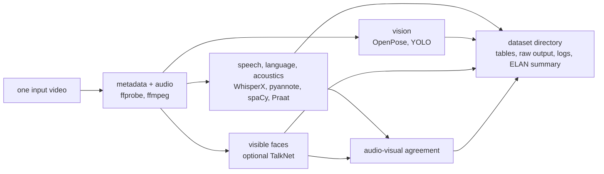

# Storytel Pipeline

[](#license)
[](docs/getting-started.md#prerequisites)
[](https://docs.astral.sh/uv/)

**Video recordings → traceable, time-aligned multimodal datasets.**

Built for researchers studying face-to-face conversation and storytelling through words,
voice and bodily movement. Each video becomes one dataset directory: normalized Parquet
tables, the byte-identical raw output of every tool that ran, a log and provenance, all on
one clock so the tables join. No accuracy claim: every stage records what it produced, skipped and why.

## What it does

| Layer | Tools and results |
|---|---|
| Speech | WhisperX transcription/alignment; pyannote turns; optional Nemotron comparison |
| Language | English segment translations; spaCy source/English tokens and sentences |
| Acoustics | Praat/Parselmouth pitch, intensity, formants and segment statistics |
| Visual | OpenPose keypoints and body-centred coordinates; optional YOLO person tracks |
| Speakers | Optional TalkNet visible-face activity and audio–visual agreement |
| Stories | Transcript-bound LLM narrative candidates, not validated detections |
| Inspection | Linked ELAN `.eaf` summaries, HTML preview and bundle helper |



Execution is sequential — one video, one stage at a time — and heavy tools live in separate
`uv` environments the root sync does not install. Nemotron diarization, TalkNet active
speaker and YOLO tracking ship disabled: [status matrix](docs/getting-started.md#what-runs-by-default).

## Quickstart

`uv`, `ffmpeg` and `ffprobe` cover the default stages; GPU tools, OpenPose, `HF_TOKEN` and an
LLM endpoint are per-stage [prerequisites](docs/getting-started.md#prerequisites). Fresh setup:

```bash
uv sync --python 3.12
cp config/config.example.yaml config/config.local.yaml && cp .env.example .env
$EDITOR config/config.local.yaml   # paths, stages and endpoints
$EDITOR .env                       # credentials; never commit this file
uv run multimodal-pipeline inspect-environment -c config/config.local.yaml
uv run multimodal-pipeline run -c config/config.local.yaml
```

Keep existing configuration and credentials instead of overwriting them; the
[installation guide](docs/getting-started.md#install) syncs each worker environment, and
translation and stories send transcript text out, so they can cost money. One video becomes
one [dataset directory](docs/datasets.md#directory-layout) under `output.directory`:

```text
<video_id>/
├── manifest.json  status.json   what exists, what is absent, what each stage decided
├── source/ audio/ speech/ translation/ linguistic/ acoustic/ pose/ persons/ speaker/ stories/
└── elan/ logs/ provenance/      ELAN summary, pipeline logs, config/tools/processing records
```

## Documentation

| Question | Guide |
|---|---|
| How do I install and process a video? | [Getting started](docs/getting-started.md) |
| How do I run, resume or select stages? | [CLI reference](docs/cli.md) |
| What settings, credentials and failure messages matter? | [Configuration](docs/configuration.md) |
| What files do I get, and how do I join their tables? | [Datasets and analysis](docs/datasets.md) |
| What do the measurements mean, and what are their limits? | [Modalities](docs/modalities.md) |
| What is exported to ELAN, and how do I share it? | [ELAN export](docs/elan.md) |
| How is the pipeline structured, and why? | [Architecture](docs/architecture.md) |
| Where is the code, and how do I test a change? | [Development](docs/development.md) |

## Status, scope and limitations

- Live work and deferrals: the [ODD tracker](odd/tasks/multimodal-video-pipeline.md).
- `.github/workflows/unit.yml` covers the unit suite on Linux with ffmpeg only: no GPU
  models, OpenPose, live endpoints or accuracy, and no hosted run is claimed here.
- Stories are LLM candidates, track IDs are not unique-human counts, and one video runs at a time (no server or queue).

## Citing

Metadata: [CITATION.cff](CITATION.cff), which GitHub's **Cite this repository** button reads.

```bibtex
@misc{storytel_pipeline,
  author  = {Sánchez, Raúl},
  title   = {Storytel Pipeline},
  version = {0.1.0},
  url     = {https://github.com/RaulKite/storytell-pipeline}
}
```

## Author and acknowledgements

Author and maintainer: **Raúl Sánchez** ([raul@um.es](mailto:raul@um.es)); open an issue for
defects, and read [Development](docs/development.md) first.

Developed for [STORYTEL](https://storytel.uni-koeln.de/), which studies spontaneous
storytelling in face-to-face conversation through words, voice and bodily movement; its
teaching activities bring together teams from Cologne (coordinator), Erlangen–Nürnberg,
Murcia and Bologna.

The pipeline drives WhisperX, [pyannote.audio](https://github.com/pyannote/pyannote-audio),
NVIDIA Nemotron, [spaCy](https://spacy.io/), [Praat](https://www.fon.hum.uva.nl/praat/) via
Parselmouth, [OpenPose](https://github.com/CMU-Perceptual-Computing-Lab/openpose),
[Ultralytics YOLO](https://docs.ultralytics.com/), TalkNet-ASD and
[ELAN](https://archive.mpi.nl/tla/elan) rather than reimplementing them; their licences and
terms stay with their authors. This is attribution, not endorsement.

## License

[MIT](LICENSE) covers this repository, not third-party media, model weights or tools, and
not the recordings you process with it.
