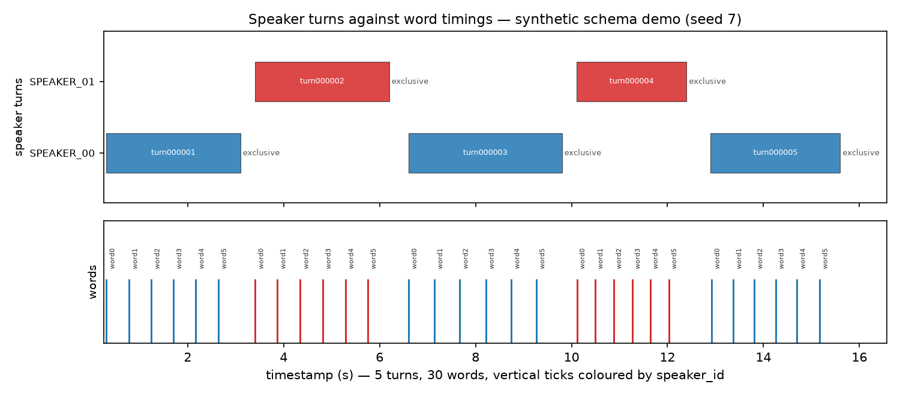

# Storytel Pipeline

**Video recordings → traceable, time-aligned multimodal datasets.**

Transcribe speech, compare diarizers, extract acoustic and visual features, and
inspect summaries in ELAN. Each video gets normalized Parquet tables, original tool
output, logs and provenance in its own dataset directory.

[Get started](docs/getting-started.md) · [Read the outputs](docs/datasets.md) ·
[Architecture and design decisions](docs/architecture.md)



*All committed figures use synthetic data, not recording frames or accuracy benchmarks.*

## What it does

| Layer | Tools / results |
|---|---|
| Speech | WhisperX transcription/alignment; pyannote turns; optional Nemotron comparison |
| Language | English segment translations; spaCy source/English tokens and sentences |
| Acoustics | Praat/Parselmouth pitch, intensity, formants and segment statistics |
| Visual | OpenPose keypoints and body-centred coordinates; optional YOLO person tracks |
| Speakers | Optional TalkNet visible-face activity and audio–visual agreement |
| Stories | Transcript-bound LLM narrative candidates, not validated detections |
| Inspection | Linked ELAN `.eaf` summaries, HTML preview and bundle helper |

Execution is sequential: one video and one stage at a time. Heavy tools use
separate `uv` environments; syncing the root project alone does **not** install them.
Stages can be disabled, and missing optional prerequisites have recorded reasons.

## First run

Install `uv`, `ffmpeg` and `ffprobe`, then follow the
[installation guide](docs/getting-started.md) for the tools you enable.
Run these commands from the repository root, on a **fresh setup only**:

```bash
uv sync --python 3.12
cp config/config.example.yaml config/config.local.yaml
cp .env.example .env
$EDITOR config/config.local.yaml   # paths, stages and endpoints
$EDITOR .env                      # credentials; never commit this file
uv run multimodal-pipeline inspect-environment -c config/config.local.yaml
uv run multimodal-pipeline run -c config/config.local.yaml
```

Keep existing local configuration and credentials instead of overwriting them.
Translation and stories can send transcript text to an endpoint and incur costs;
configure them deliberately or disable them.

```bash
uv run multimodal-pipeline status -c config/config.local.yaml --plan
uv run multimodal-pipeline validate -c config/config.local.yaml --json
```

## Where to read next

| Question | Guide |
|---|---|
| How do I install and process a video? | [Getting started](docs/getting-started.md) |
| How do I run, resume or select stages? | [CLI reference](docs/cli.md) |
| What settings, credentials and failure messages matter? | [Configuration](docs/configuration.md) |
| What files do I get, and how do I join their tables? | [Datasets and analysis](docs/datasets.md) |
| What do the measurements mean, and what are their limits? | [Modalities](docs/modalities.md) |
| What is exported to ELAN, and how do I share it? | [ELAN export](docs/elan.md) |
| How is the pipeline structured, and why? | [Architecture](docs/architecture.md) |
| Where is the code, and how do I test a change? | [Development](docs/development.md) |

Start a dataset analysis from `manifest.json`, not guessed filenames. Its artifact
paths and declared absences explain what was produced. Separate clocks and track-ID
namespaces matter: see the [consumer rules](docs/datasets.md#consumer-rules).

Current work and deferred questions live in the compact
[ODD tracker](odd/tasks/multimodal-video-pipeline.md). Historical plans and run diaries
are retained in Git history, not in the user documentation.

## License

[MIT](LICENSE) covers this repository, not third-party media, model weights or tools.
