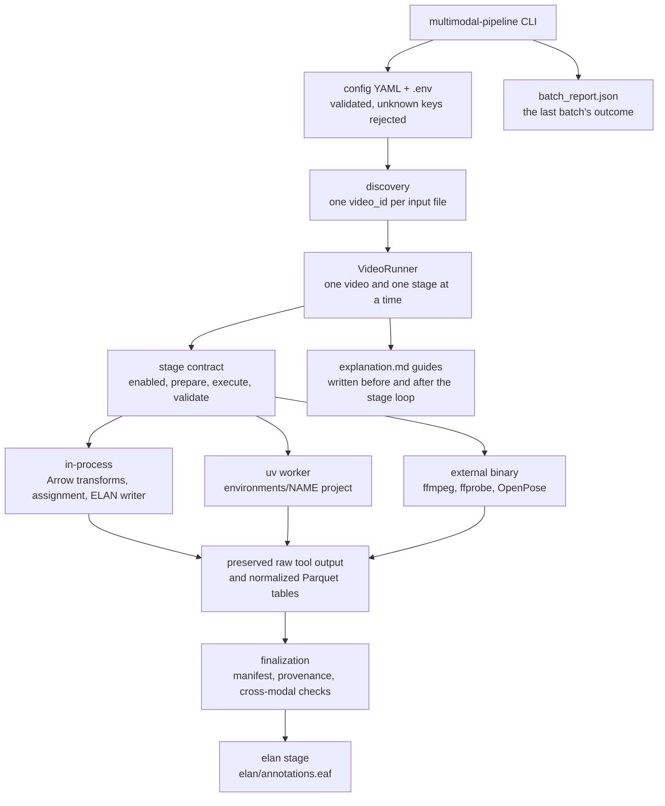
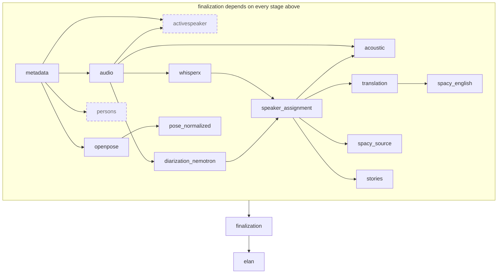
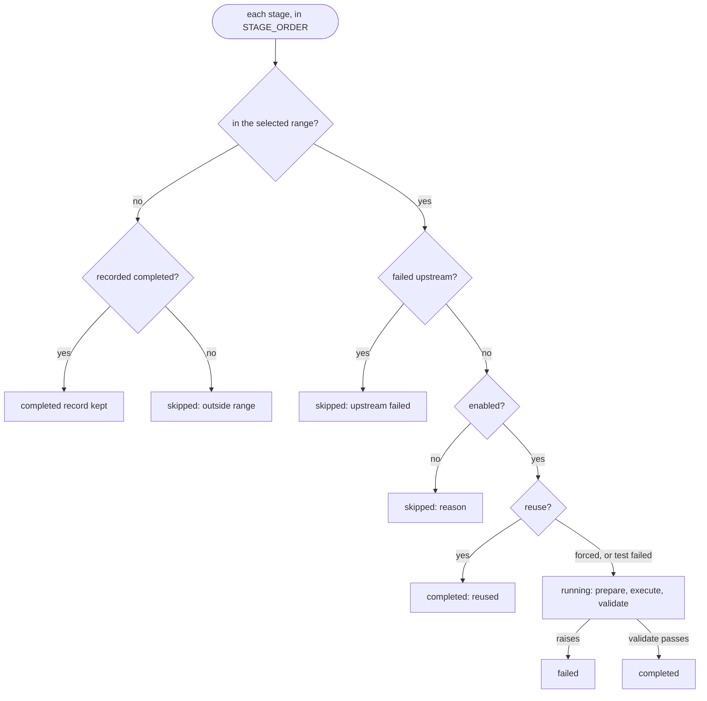
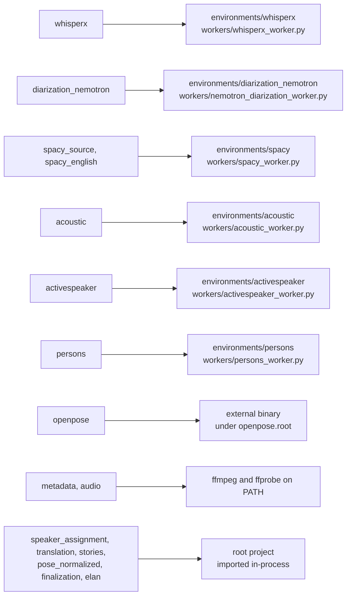

# Architecture

A lightweight, sequential orchestrator coordinates isolated tools and publishes one
traceable dataset per video. This guide explains the boundaries, dependency graph,
reuse rules and design decisions; measurement semantics live in [Modalities](modalities.md).

Back to the overview: [Storytel Pipeline](../README.md).

## Contents

- [System boundaries](#system-boundaries)
- [Stage dependencies](#stage-dependencies)
- [Execution and failure handling](#execution-and-failure-handling)
- [Resume, reuse and invalidation](#resume-reuse-and-invalidation)
- [Design decisions](#design-decisions)
- [Why six environments](#why-six-environments)

## System boundaries

The columns are a boundary: a heavy model lives in a declared `uv` project and a worker,
so the orchestrator imports no torch, spaCy or Parselmouth.

| Responsibility | Source |
|---|---|
| Commands, config, discovery | [`cli.py`](../src/multimodal_pipeline/cli.py), [`config.py`](../src/multimodal_pipeline/config.py), [`discovery.py`](../src/multimodal_pipeline/discovery.py) |
| DAG and uniform stage contract | [`stages/base.py`](../src/multimodal_pipeline/stages/base.py) |
| Per-video planning and execution | [`orchestrator.py`](../src/multimodal_pipeline/orchestrator.py) |
| State and artifact paths | [`state.py`](../src/multimodal_pipeline/state.py), [`artifacts.py`](../src/multimodal_pipeline/artifacts.py) |
| Tables, normalization and checks | [`schemas.py`](../src/multimodal_pipeline/schemas.py), [`normalization.py`](../src/multimodal_pipeline/normalization.py), [`validation.py`](../src/multimodal_pipeline/validation.py) |
| Tool launch and provenance | [`uv_worker.py`](../src/multimodal_pipeline/uv_worker.py), [`subprocess_utils.py`](../src/multimodal_pipeline/subprocess_utils.py), [`provenance.py`](../src/multimodal_pipeline/provenance.py) |
| Export and summaries | [`manifest.py`](../src/multimodal_pipeline/manifest.py), [`elan.py`](../src/multimodal_pipeline/elan.py), [`report.py`](../src/multimodal_pipeline/report.py) |

Workers communicate through files and subprocess results, not shared model objects.

## Stage dependencies

Rows follow `STAGE_ORDER`; dependencies are the direct edges of `STAGE_DEPENDENCIES`.
An execution position does not imply a dependency on the preceding stage.

Dashed nodes are disabled in `config/config.example.yaml` and need an extra install or
checkout: a shipping default, not an unimplemented feature. See the
[stage status matrix](getting-started.md#what-runs-by-default) for prerequisites.

| Stage | Direct dependencies | Work |
|---|---|---|
| `metadata` | — | ffprobe, source identity and frame timestamps |
| `audio` | `metadata` | ffmpeg extraction |
| `whisperx` | `audio` | Transcription and word alignment |
| `diarization_nemotron` | `audio` | Nemotron speaker turns |
| `speaker_assignment` | `whisperx`, `diarization_nemotron` | Apply Nemotron labels to segments/words |
| `translation` | `speaker_assignment` | English translations |
| `spacy_source` | `speaker_assignment` | Source-language annotations |
| `spacy_english` | `translation` | English annotations |
| `acoustic` | `audio`, `speaker_assignment` | Praat frames and segment aggregates |
| `openpose` | `metadata` | Body, hand and face landmarks |
| `pose_normalized` | `openpose` | Body-centred coordinates |
| `activespeaker` | `metadata`, `audio` | TalkNet face activity |
| `persons` | `metadata` | YOLO person detection/tracking |
| `stories` | `speaker_assignment` | Narrative candidates from the source transcript |
| `finalization` | All producer stages above | Cross-modal validation, manifest and provenance |
| `elan` | `finalization` | Annotation summary export |

## Execution and failure handling

One video and one stage run at a time to keep GPU memory predictable, and a failed stage
blocks its dependants, not unrelated branches: a transcription failure does not stop
`openpose` or `persons` from reading frames.

Every stage goes through the same decision, in `VideoRunner._run_stage`:

`skipped` and `failed` are different records on purpose: a skip names a chosen reason or
an absent prerequisite, a failure an error, a zero-row table neither. Unstated details: a
forced stage
resets its record and skips the reuse test, and an exception in `prepare` or `execute`
fails the stage before validation is reached. Beyond the flow, a broken required tool
fails with its own error (only explicitly optional checks, such as Nemotron's missing
environment directory, become skips), and `execution.stop_on_video_error` stops the batch
only on a video whose overall result is `failed`, not on a `partial` one.

`finalization` excludes `elan` from its dependencies to avoid a cycle, and the runner's
closing summary refresh includes the export after it has run: a manifest read mid-run is
not the final inventory. A producer failure can still block finalization, and with it
ELAN — an unrelated branch surviving does not mean every summary stage completes.

## Resume, reuse and invalidation

`status.json` is the resume record. Reuse requires all five:

1. Recorded status is `completed`.
2. The stage's configuration/tool/source fingerprint is unchanged.
3. Its transitive upstream configuration and execution sequences are unchanged.
4. Required output artifacts still exist.
5. Stage validation passes and recorded Parquet row counts still match.

`status --plan` and `run` share the reuse decision. Monotonic execution sequence
numbers, rather than filesystem mtimes, detect fast upstream reruns. Fingerprints
exclude a stage's own generated bookkeeping, so finalization does not invalidate itself.

Stages can reuse retained raw output for normalization when their tool-request identity
still matches. Request identity and normalization identity are separate: a schema or
transform edit need not rerun an expensive model, while a changed model or request must
not reuse an incompatible raw result. `--only-stage` expands to the dependency chain;
`--from-stage`/`--to-stage` only slice `STAGE_ORDER` ([CLI controls](cli.md#stage-controls)).

## Design decisions

| Decision | Reason and trade-off |
|---|---|
| One dataset directory per video | Portable artifact paths and inspectable state; no database service needed |
| Raw output beside typed Parquet | Preserve evidence while providing a uniform analysis format; uses more disk |
| Seconds from video start, explicit working grids | Cross-tool alignment without pretending every frame index names a source frame |
| Missing / empty / imputed are distinct | Unknown evidence must not become a measured zero or a claim of absence |
| Derived tables beside measurements | Normalized pose never silently redefines the source measurement |
| One diarizer | Nemotron is the only speaker-timeline producer; transcript assignment reads its turns |
| Story candidates use the source transcript | Translation and visible-face analysis are not prerequisites for narrative evidence |
| `MidHip → Neck` pose basis | Longer torso baseline reduces jitter amplification; missing defining joints yield nulls |
| YOLO nano + ByteTrack defaults | Small checkpoint and no re-ID download; fragmentation remains inspectable, not proof of identities |
| `en_core_web_lg` for English | Avoids adding a transformer/torch stack to the linguistic environment |
| ELAN is a derived summary | Usable tiers without exporting every dense coordinate or claiming story validation |

Current scope excludes parallel/multi-GPU scheduling, a web UI/database, speaker
identification, retraining, subtitles, transliteration and gaze estimation.

## Why six environments

Heavy tools have incompatible torch/CUDA and dependency requirements, so each has an
independent `uv` project under [`environments/`](../environments), launched by
`uv run --project environments/<name> python workers/<name>_worker.py` (worker filenames
are configured, not inferred from the environment name).

A stage with no worker is pure Python over Parquet or HTTP: a re-read, not a model run.

| Environment | Constraint worth preserving |
|---|---|
| `whisperx` | Its transcription/alignment torch stack |
| `diarization_nemotron` | Pinned unreleased transformers architecture; separate CUDA resolution |
| `spacy` | Language models without importing them into the orchestrator |
| `acoustic` | Parselmouth/Praat and numpy |
| `activespeaker` | torch 2.5.1: TalkNet's checkpoints use `torch.load()` without `weights_only=` |
| `persons` | Ultralytics detection/tracking and its own torch stack |

Exact pins and their rationale live in each `pyproject.toml`: read those comments before
upgrading. See [Development](development.md) and [Configuration](configuration.md).
