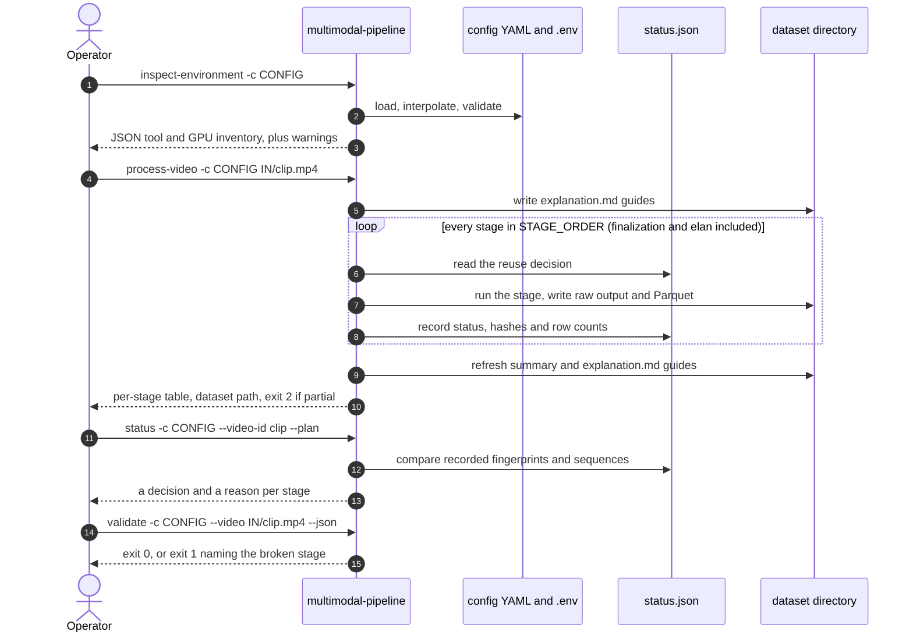

# CLI reference

Use `multimodal-pipeline` through `uv run` to process, resume, inspect and validate
videos. Commands operate on the output directory selected by the configuration and use
repository-relative paths: run them from the repository root.

Back to the overview: [Storytel Pipeline](../README.md).

## Contents

- [Commands](#commands)
- [Stage controls](#stage-controls)
- [Worked example: one video, end to end](#worked-example-one-video-end-to-end)
- [Status output](#status-output)
- [Exit codes](#exit-codes)

## Commands

| Command | Purpose |
|---|---|
| `run` | Process the discovered input videos sequentially |
| `resume` | Continue using validated previous stage results |
| `retry-failed` | Force the stages downstream of a failed one; that stage reruns anyway |
| `process-video <file>` | Process a single explicit path |
| `status` | Inspect stage outcomes; `--plan` estimates reuse, `--json` supports scripts |
| `validate` | Check existing artifacts without processing; optional `--json` |
| `inspect-environment` | Tools/models/GPU inventory as JSON, always; no flag needed |

```bash
uv run multimodal-pipeline --help
uv run multimodal-pipeline run --help
uv run multimodal-pipeline run -c config/config.local.yaml
uv run multimodal-pipeline resume -c config/config.local.yaml
uv run multimodal-pipeline retry-failed -c config/config.local.yaml
uv run multimodal-pipeline process-video -c config/config.local.yaml path/to/clip.mp4
uv run multimodal-pipeline status -c config/config.local.yaml --plan
uv run multimodal-pipeline validate -c config/config.local.yaml --json
```

`validate` gets the output directory from config (no `-o` flag). JSON goes to stdout,
human tables and messages to stderr; `inspect-environment` always prints JSON.

Every command that processes or validates accepts `--video <path>`. `status` takes
`--video-id <id>` instead and can only report videos discovered under `input.directory`,
so a file processed from elsewhere is invisible to it.

## Stage controls

`run` and `process-video` share these controls:

| Flag | Effect |
|---|---|
| `--only-stage acoustic` | Select that stage and its prerequisites |
| `--from-stage whisperx` | Start the requested range here |
| `--to-stage acoustic` | Stop the requested range here |
| `--force-stage whisperx,acoustic` | Recompute these stages even if reusable |

`run --video clip.mp4` selects one file; a bare filename resolves under
`input.directory`. `process-video` instead takes its file as a positional argument.
Stage names and ordering are in [Architecture](architecture.md#stage-dependencies).

```bash
uv run multimodal-pipeline run -c config/config.local.yaml --only-stage elan
uv run multimodal-pipeline run -c config/config.local.yaml --force-stage whisperx
```

In a full run, an upstream recomputation invalidates its downstream stages. An
explicit selection restricts which stages execute; unselected dependants are not
silently added just because you forced an upstream stage. In particular,
`--only-stage elan` includes prerequisites: it is export-only **when they are already
reusable**. Check `status --plan` before assuming an inexpensive refresh.

## Worked example: one video, end to end

One clip, from an unconfigured machine to an ELAN file. Keep the clip inside
`input.directory` from the start: that is the only list the follow-up commands agree on.



**Check what the machine offers.** It needs a config to report tools and warnings:

```bash
uv run multimodal-pipeline inspect-environment -c config/config.local.yaml
```

Read `environment_warnings` before spending an hour on a batch: it names a missing
credential, an unconfigured endpoint, a missing OpenPose binary and a missing `uv` project.

**Process the clip.** Copy it into `input.directory` — `data/input_videos/` in these
examples — and pass that path; the file is a positional argument, not `--video`:

```bash
cp path/to/clip.mp4 data/input_videos/
uv run multimodal-pipeline process-video -c config/config.local.yaml data/input_videos/clip.mp4
```

The dataset lands in `<output.directory>/<video_id>/`; the run prints that path, one
line per stage, and exits `2` when the video ended `partial` or `failed`. The video id
is the file stem (`clip` here) unless another input shares it, in which case discovery
adds a suffix — use the id and path the run printed in the commands below.

**Ask why a stage would run again:**

```bash
uv run multimodal-pipeline status -c config/config.local.yaml --video-id clip --plan
```

Each stage is listed with its reason — `configuration changed`, `upstream dependency
changed`, `outputs changed`, `validation failed`, `valid previous result`, `disabled: …`.
Trust the reason text over the one-word decision beside it: the reason says what to do
about the stage.

Treat the plan as an estimate from the dataset as it stands, not a forecast: some stage
fingerprints read artifacts already on disk, so asking for a plan on a clip that was
never processed can exit with `StageError: audio stage requires metadata.json` instead of
printing a table. Even after a real run it can differ from what a following `run`
does: a dependent marked blocked by a recorded failure may run once that failure is
repaired upstream.

**Resume, or retry what broke:**

```bash
uv run multimodal-pipeline resume -c config/config.local.yaml --video data/input_videos/clip.mp4
uv run multimodal-pipeline retry-failed -c config/config.local.yaml --video data/input_videos/clip.mp4
```

`resume` is `run` again: stages whose five reuse conditions hold are reused, none forced.

`retry-failed` reads `status.json`, forces every stage **downstream** of a failed one and
prints that forced list before processing; the same list, expanded with its
prerequisites, is the stage selection. A failed stage appears on the list only when it is
also downstream of another failure (with `translation` and `elan` both failed, `elan` is
listed); otherwise it reruns because a failed record never satisfies the reuse test. Two consequences worth knowing:
a failure in `elan`, the one stage nothing depends on, yields an empty forced list and
the command falls back to the full stage order; and with no failed stage in the selected
videos it exits `0` without processing. It also accepts no stage controls — the forced
set is the whole selection.

**Refresh one end of the pipeline:**

```bash
uv run multimodal-pipeline run -c config/config.local.yaml --video data/input_videos/clip.mp4 --only-stage elan
uv run multimodal-pipeline run -c config/config.local.yaml --video data/input_videos/clip.mp4 --force-stage acoustic
```

`--only-stage` keeps the prerequisites, so an export is cheap only when they are
reusable. `--force-stage` recomputes a stage even when reusable. Without `--video`, both
apply to every video in `input.directory`.

**Validate what is on disk.** No processing happens here:

```bash
uv run multimodal-pipeline validate -c config/config.local.yaml --video data/input_videos/clip.mp4 --json
```

Without `--video` it checks every discovered video. Each completed stage's validation
reruns and recorded row counts are compared; exit `1` means an artifact is missing,
changed shape or is invalid. Skipped stages are reported as skipped, not failed.

**Open the result in ELAN.** An `.eaf` needs an audio stream in the source and a
successful transcription: without audio there are no words to align, and `elan` skips
with a reason when neither `speech/words.parquet` nor `speech/segments.parquet` exists.
Open `elan/annotations.eaf` under the dataset path the run printed, and keep that
directory intact so the relative media link still resolves. Without ELAN at hand, the
same file rendered as HTML:

```bash
DATASET=data/processed/clip   # the dataset path the run printed
uv run python scripts/make_elan_view.py "$DATASET/elan/annotations.eaf" /tmp/view.html
```

The preview shows tiers and bars and never plays the video; see
[ELAN preview and refresh](elan.md#preview-and-refresh).

## Status output

Stage columns use numeric indices, with stage names and state marks in the legend.
Long video IDs are printed separately rather than truncated. `ov` is overall status.

Marks: `c=completed`, `F=failed`, `P=partial`, `.=pending`, `r=running`, `s=skipped`.
Use `--plan` for the per-stage reason that separates a configuration change, a missing
output, a failed validation and an explicit skip; the reason text is what to read.
`status.json` remains the machine-readable resume record.

## Exit codes

| Code | Meaning |
|---|---|
| `0` | Successful command; processing completed without failed/partial videos |
| `1` | `validate` found an invalid artifact, or `status` received an unknown video ID |
| `2` | Processing had a failed/partial video, or configuration/CLI usage was invalid |

Code `2` does **not** distinguish a usage error from partial processing. Inspect
stderr or structured output to tell them apart. See
[Configuration troubleshooting](configuration.md#troubleshooting) for common causes.
