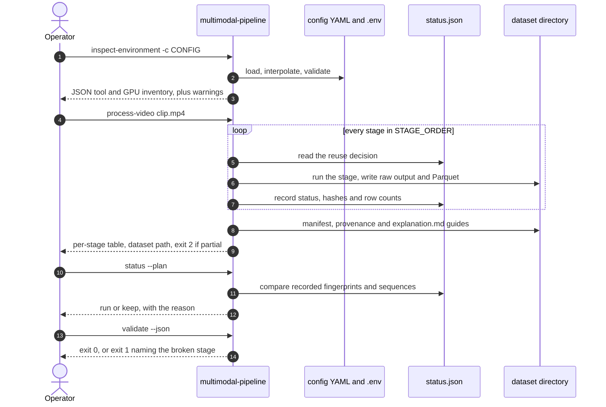

# CLI reference

Use `multimodal-pipeline` through `uv run` to process, resume, inspect and validate
videos. Commands operate on the output directory selected by the configuration.

Back to the overview: [Storytel Pipeline](../README.md).

Commands use repository-relative paths: run them from the repository root.

## Contents

- [Commands](#commands)
- [Stage controls](#stage-controls)
- [Worked example: one video, end to end](#worked-example-one-video-end-to-end)
- [Status output](#status-output)
- [Exit codes](#exit-codes)

## Commands

| Command | Purpose |
|---|---|
| `run` | Process the discovered input videos sequentially |
| `resume` | Continue using validated previous stage results |
| `retry-failed` | Force failed stages, invalidating dependent results |
| `process-video <file>` | Process a single explicit path |
| `status` | Inspect stage outcomes; `--plan` explains reuse, `--json` supports scripts |
| `validate` | Check existing artifacts without processing; optional `--json` |
| `inspect-environment` | Tools/models/GPU inventory as JSON, always; no flag needed |

```bash
uv run multimodal-pipeline --help
uv run multimodal-pipeline run --help
uv run multimodal-pipeline run -c config/config.local.yaml
uv run multimodal-pipeline resume -c config/config.local.yaml
uv run multimodal-pipeline retry-failed -c config/config.local.yaml
uv run multimodal-pipeline process-video -c config/config.local.yaml path/to/clip.mp4
uv run multimodal-pipeline status -c config/config.local.yaml --plan
uv run multimodal-pipeline validate -c config/config.local.yaml --json
```

`validate` gets the output directory from config; it has no `-o` flag.
JSON command output goes to stdout, human tables/messages to stderr.
`inspect-environment` does not accept `--json` because JSON is unconditional.

## Stage controls

`run` and `process-video` share these controls:

| Flag | Effect |
|---|---|
| `--only-stage acoustic` | Select that stage and its prerequisites |
| `--from-stage whisperx` | Start the requested range here |
| `--to-stage acoustic` | Stop the requested range here |
| `--force-stage whisperx,acoustic` | Recompute these stages even if reusable |

`run --video clip.mp4` selects one file; a bare filename resolves under
`input.directory`. `process-video` instead takes its file as a positional argument.
Stage names and ordering are in [Architecture](architecture.md#stage-dependencies).

```bash
uv run multimodal-pipeline run -c config/config.local.yaml --only-stage elan
uv run multimodal-pipeline run -c config/config.local.yaml --force-stage whisperx
```

In a full run, an upstream recomputation invalidates its downstream stages. An
explicit selection restricts which stages execute; unselected dependants are not
silently added just because you forced an upstream stage. In particular,
`--only-stage elan` includes prerequisites: it is export-only **when they are already
reusable**. Check `status --plan` before assuming an inexpensive refresh.

## Worked example: one video, end to end

One clip, from an unconfigured machine to an ELAN file.



**Check what the machine offers.** It needs a config to report tools and warnings:

```bash
uv run multimodal-pipeline inspect-environment -c config/config.local.yaml
```

Read `environment_warnings` before spending an hour on a batch: it names a missing
credential, an unconfigured endpoint, a missing OpenPose binary and a missing `uv` project.

**Process the clip.** The file is a positional argument, not `--video`:

```bash
uv run multimodal-pipeline process-video -c config/config.local.yaml path/to/clip.mp4
```

The dataset lands in `<output.directory>/<video_id>/`. The run prints one line per stage
and exits `2` when the video ended `partial` or `failed`.

**Ask why a stage would run again:**

```bash
uv run multimodal-pipeline status -c config/config.local.yaml --plan
```

Each stage prints as `run ` or `keep` with its reason (`configuration changed`,
`upstream dependency changed`, `outputs changed`, `validation failed`). `status` and `run`
share the decision, so the plan is what the next run does.

**Resume, or retry only what broke:**

```bash
uv run multimodal-pipeline resume -c config/config.local.yaml
uv run multimodal-pipeline retry-failed -c config/config.local.yaml
```

`resume` is `run` again: every stage whose five reuse conditions still hold is reused.
`retry-failed` forces the failed stages and their dependants, and says so instead of
running when no stage failed.

**Refresh one end of the pipeline:**

```bash
uv run multimodal-pipeline run -c config/config.local.yaml --only-stage elan
uv run multimodal-pipeline run -c config/config.local.yaml --force-stage acoustic
```

`--only-stage` keeps the prerequisites, so an export is cheap only when they are
reusable. `--force-stage` recomputes a stage even when it is reusable.

**Validate what is on disk.** No processing happens here:

```bash
uv run multimodal-pipeline validate -c config/config.local.yaml --json
```

Each completed stage's own validation runs again and its recorded Parquet row counts are
compared. Exit `1` means an artifact is missing, changed shape or is semantically invalid;
skipped stages are reported as skipped, not failed.

**Open the result in ELAN.** Open `elan/annotations.eaf` with ELAN and keep the dataset
directory intact, so the relative media link still resolves. Without ELAN at hand:

```bash
uv run python scripts/make_elan_view.py data/processed/pipeline_demo/elan/annotations.eaf /tmp/view.html
```

The preview shows tiers and bars and never plays the video; see
[ELAN preview and refresh](elan.md#preview-and-refresh).

## Status output

Stage columns use numeric indices, with stage names and state marks in the legend.
Long video IDs are printed separately rather than truncated. `ov` is overall status.

Marks: `c=completed`, `F=failed`, `P=partial`, `.=pending`, `r=running`, `s=skipped`.
Use `--plan` to distinguish configuration changes, missing outputs, validation
failures and explicit skips. `status.json` remains the machine-readable resume record.

## Exit codes

| Code | Meaning |
|---|---|
| `0` | Successful command; processing completed without failed/partial videos |
| `1` | `validate` found an invalid artifact, or `status` received an unknown video ID |
| `2` | Processing had a failed/partial video, or configuration/CLI usage was invalid |

Code `2` does **not** distinguish a usage error from partial processing. Inspect
stderr or structured output to tell them apart. See
[Configuration troubleshooting](configuration.md#troubleshooting) for common causes.
