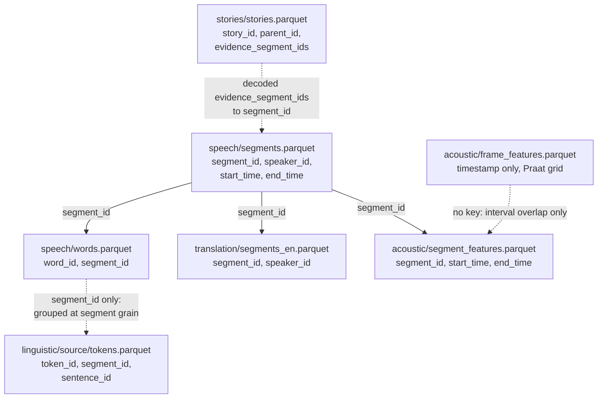
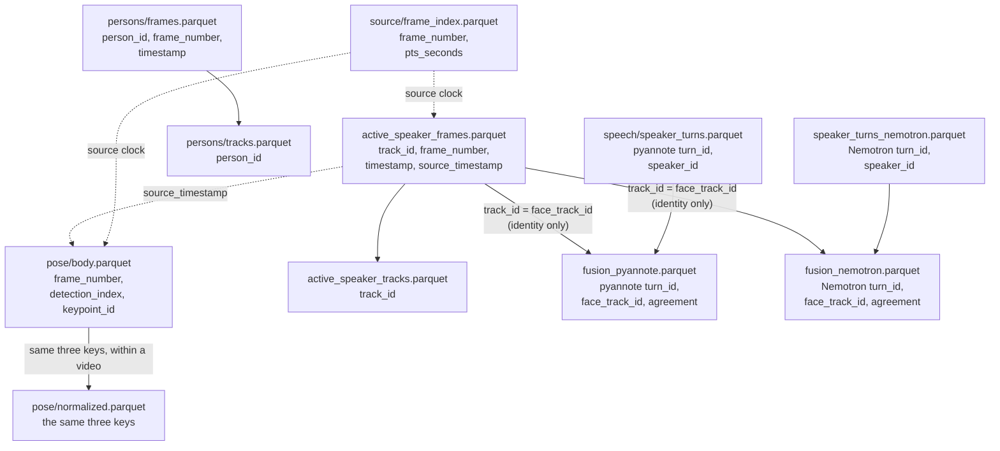
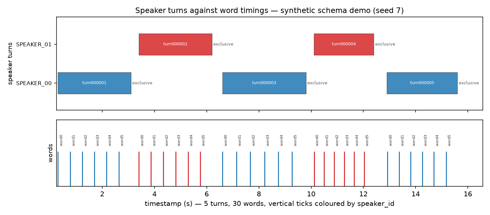

# Datasets and analysis

Start from the manifest to discover outputs, then read the typed Parquet tables.
This guide maps the files and explains the clocks, identifiers and missing values
that matter when combining modalities.

Back to the overview: [Storytel Pipeline](../README.md).

Commands use repository-relative paths: run them from the repository root.

## Contents

- [Directory layout](#directory-layout)
- [Table reference](#table-reference)
- [How the tables join](#how-the-tables-join)
- [Speaker timing example](#speaker-timing-example)
- [Read a dataset](#read-a-dataset)
- [Consumer rules](#consumer-rules)

## Directory layout

```text
<output.directory>/<video_id>/
├── manifest.json       artifact paths, details, declared absences and temporal model
├── status.json         stage outcomes, fingerprints and recorded validation results
├── source/             metadata.json + frame_index.parquet
├── audio/              audio.wav + audio_info.json
├── speech/             transcript, alignment, diarization + raw tool output
├── translation/        English segments + raw responses/cache
├── linguistic/         source/ and english/ tokens, sentences + raw results
├── acoustic/           frame and segment features + raw JSONL
├── pose/               body, hands, face, normalized + raw/ and optional raw_images/
├── persons/            detections, tracks + raw/yolo_track.json
├── speaker/            active-speaker evidence, fusion + raw/
├── stories/            candidates + raw responses/cache
├── elan/               annotations.eaf
├── logs/               pipeline.log + <stage>.log
└── provenance/         config.json, tools.json, processing.json
```

This is the possible layout, not a promise that every file exists in every run.
`manifest.artifacts` maps logical names to **dataset-relative paths** and
`artifacts_not_generated` declares absent outputs; never hardcode a corpus count.

Set `activespeaker.write_video: true` to retain TalkNet's native annotated video with
audio as `speaker/raw/video_out.avi` (`activespeaker_video_raw` in the manifest). It is
opt-in, requires ASD recomputation, and preserves an existing video when turned off;
manifest presence reports files on disk, not the current toggle.

Set `openpose.write_video: true` to produce `pose/skeletons.mp4`
(`pose_skeleton_video` in the manifest), independently of `write_images`. It retains
OpenPose's native rendering, muxes source audio when available, reruns OpenPose when
enabled and deletes nothing when disabled. Publication is atomic for the video, not a
transaction across all pose outputs: native output, normalization, mux and validation are
staged before previous pose outputs are replaced, and `extra_args` cannot override native
video flags. Native preview timing can lose trailing frames (validation allows at most
three against current raw JSON counts), so use `source/frame_index.parquet` and the pose
tables for measured source-frame timing.

Each dataset folder receives an English `explanation.md` on run/resume, including reused
outputs: contract guides, not evidence that a module produced data, excluded from artifact
counts and model fingerprints. Unmarked hand-written guides are preserved.

Raw outputs remain beside normalized tables, with provenance in sidecars and the
provenance directory rather than injected into raw bytes. The config snapshot masks
secrets, but logs and tool provenance can still contain machine paths.

## Table reference

These are the registered Parquet outputs. For every field/type, consult
[`schemas.py`](../src/multimodal_pipeline/schemas.py); for all raw and bookkeeping
paths, consult [`ARTIFACT_LAYOUT`](../src/multimodal_pipeline/artifacts.py).
Presence is determined by the manifest, not this inventory.

| Artifact key | Dataset-relative path | Meaning |
|---|---|---|
| `frame_index` | `source/frame_index.parquet` | Source frame number → PTS seconds |
| `speech_segments` | `speech/segments.parquet` | Transcript segments, language and assigned speaker |
| `speech_words` | `speech/words.parquet` | Words, alignment state and confidence |
| `speaker_turns` | `speech/speaker_turns.parquet` | pyannote intervals |
| `speaker_turns_nemotron` | `speech/speaker_turns_nemotron.parquet` | Independent Nemotron intervals |
| `translation_segments` | `translation/segments_en.parquet` | English text keyed by transcript segment |
| `spacy_source_tokens` | `linguistic/source/tokens.parquet` | Source token annotations and timing state |
| `spacy_source_sentences` | `linguistic/source/sentences.parquet` | Source sentence annotations |
| `spacy_english_tokens` | `linguistic/english/tokens.parquet` | English translation token annotations |
| `spacy_english_sentences` | `linguistic/english/sentences.parquet` | English translation sentence annotations |
| `acoustic_frames` | `acoustic/frame_features.parquet` | Pitch, intensity, voicing and formants |
| `acoustic_segments` | `acoustic/segment_features.parquet` | Segment aggregates and pause statistics |
| `pose_body` | `pose/body.parquet` | BODY_25 keypoints in source pixels |
| `pose_hands` | `pose/hands.parquet` | Left/right hand keypoints |
| `pose_face` | `pose/face.parquet` | Face landmarks |
| `pose_normalized` | `pose/normalized.parquet` | Body-centred keypoints and basis/value status |
| `active_speaker_frames` | `speaker/active_speaker_frames.parquet` | Dense selected-face activity on TalkNet's 25 FPS grid |
| `active_speaker_tracks` | `speaker/active_speaker_tracks.parquet` | TalkNet face-track summaries |
| `person_frames` | `persons/frames.parquet` | YOLO detections and body-track IDs |
| `person_tracks` | `persons/tracks.parquet` | Body-track summaries and sighting gaps |
| `speaker_fusion_pyannote` | `speaker/fusion_pyannote.parquet` | pyannote turn × face evidence agreement |
| `speaker_fusion_nemotron` | `speaker/fusion_nemotron.parquet` | Nemotron turn × face evidence agreement |
| `stories` | `stories/stories.parquet` | LLM candidates with transcript evidence and request identity |

### How the tables join

The tables fall into two families joined mostly by time, so they are drawn apart; the one
shared id between them is pyannote's `speaker_id`, explained below. Speech, text and acoustics:



Then turns, clocks, pose, persons and agreement (filenames shortened; see the table above):



Solid edges are id joins; dotted ones are overlap, a shared clock or a coarser-grain id.
None is a declared foreign key; `finalization` checks only that translation rows cite an
existing `segment_id` and that transcript `speaker_id`s appear in pyannote's turns.

The families meet through overlap and one shared id: a turn table against the transcript,
TalkNet's frames against the turns (what the fused tables measure), and pyannote's labels
in the transcript's `speaker_id` column. Each diarizer numbers its own turns from one, so
`turn000001` means something only inside the file that wrote it — hence one fused file per
engine. `face_track_id` names a TalkNet `track_id`, never a diarizer `speaker_id`; that id
alone also returns frames outside the turn, while agreement uses working-grid `timestamp`s
inside it, both endpoints included.

## Speaker timing example

A synthetic example of `speaker_turns` beside `speech_words` — separate records, not
measured accuracy. See [Consumer rules](#consumer-rules) before joining them.



## Read a dataset

Run this with `uv run python` in the root environment, on a dataset your configuration
produced; there is no required local demo dataset.

```python
import json
from pathlib import Path
import pyarrow.parquet as pq
dataset = Path("data/processed/pipeline_demo")
manifest = json.loads((dataset / "manifest.json").read_text())
status = json.loads((dataset / "status.json").read_text())
print("source:", manifest["source"])
print("not generated:", manifest["artifacts_not_generated"])
for name, stage in status["stages"].items():
    print(name, stage["status"])

def read(name):  # KeyError names the artifact this run did not produce
    relative = manifest["artifacts"][name]
    return pq.read_table(dataset / relative)

words = read("speech_words")
print(words.schema)               # field types and metadata
print(words.slice(0, 5).to_pylist())
```

Use Arrow directly for large tables; for pandas call `read("speech_words").to_pandas()`
after adding pandas to your analysis environment. Group within one video before joining:
IDs from two datasets need not be globally unique.

## Consumer rules

| Rule | Safe interpretation |
|---|---|
| Time unit | Seconds from video start; intervals use `start_time`/`end_time`, instants use `timestamp` |
| Source clock | `frame_index.pts_seconds` maps source frames; metadata logs a fallback if packet timing cannot be read |
| Acoustic clock | Praat's configured time step, not video-frame numbers; audio duration can differ slightly from container duration |
| TalkNet clock | One row per 25 FPS working-grid frame, **not** per source frame; `timestamp` is grid time and `source_timestamp` maps to the nearest source PTS |
| Track namespaces | Each diarizer's `speaker_id`, YOLO `person_id` and TalkNet `track_id` are independent |
| Explicit face link | Fusion `face_track_id` refers to TalkNet `track_id` in the same dataset, not to a diarizer speaker |
| Empty vs absent | Zero rows with a schema can mean a completed analysis found nothing; absence needs a stage/manifest reason |
| Missing vs zero | Null is not a measured zero; inspect alignment, basis, face and model-capability status fields |
| Imputed vs measured | `score_imputed` means carried evidence, not a fresh TalkNet measurement |

For pose/ASD comparisons, join on `source_timestamp`, never on `frame_number`: the
TalkNet index counts re-encoded frames, and several working-grid rows can map to one
source frame. For interval/instant joins state your boundary rule explicitly (usually
`start_time <= timestamp < end_time`) and inspect overlapping diarizer turns.

Translation joins transcript segments by `segment_id`, not word position: English
tokens are not one-to-one source tokens and their times can be approximate. Speaker
assignment rewrites the transcript tables with pyannote labels, not the WhisperX raw
output.

Read [Modalities](modalities.md) before interpreting confidence, person counts or
story candidates. Read [ELAN export](elan.md) for what an annotation summary leaves out.
