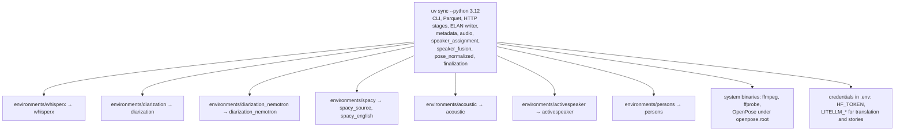

# Getting started

Install only the tools you intend to run, configure a local input/output directory,
and process your first video. Root installation and model installation are separate.

Back to the overview: [Storytel Pipeline](../README.md).

Commands use repository-relative paths: run them from the repository root.

## Contents

- [What runs by default](#what-runs-by-default)
- [Prerequisites](#prerequisites)
- [Install](#install)
- [Configure](#configure)
- [Check and run](#check-and-run)
- [Optional synthetic demo](#optional-synthetic-demo)

## What runs by default

Every stage below is implemented at this commit; none is experimental. What differs is
what a fresh clone gets for free.

| Stage | Shipped example | Also needs | Main outputs | Read |
|---|---|---|---|---|
| `metadata` | always | ffprobe | `source/metadata.json`, `source/frame_index.parquet` | [Datasets](datasets.md#table-reference) |
| `audio` | always | ffmpeg | `audio/audio.wav` | [Datasets](datasets.md#directory-layout) |
| `whisperx` | on | its environment | `speech/segments.parquet`, `speech/words.parquet` | [Modalities](modalities.md#speech-and-language) |
| `diarization` | on | `HF_TOKEN`, its environment | `speech/speaker_turns.parquet` | [Modalities](modalities.md#speech-and-language) |
| `diarization_nemotron` | **off** | its environment, model download | `speech/speaker_turns_nemotron.parquet` | [Modalities](modalities.md#speech-and-language) |
| `speaker_assignment` | conditional | a diarization result | rewrites the transcript tables with `speaker_id` | [Modalities](modalities.md#speech-and-language) |
| `translation` | on | endpoint, key, model | `translation/segments_en.parquet` | [Modalities](modalities.md#speech-and-language) |
| `spacy_source` | on | its environment, a language model | `linguistic/source/tokens.parquet`, `linguistic/source/sentences.parquet` | [Configuration](configuration.md#language-policy) |
| `spacy_english` | conditional | an English translation, its environment | `linguistic/english/tokens.parquet`, `linguistic/english/sentences.parquet` | [Configuration](configuration.md#language-policy) |
| `acoustic` | on | its environment | `acoustic/frame_features.parquet`, `acoustic/segment_features.parquet` | [Modalities](modalities.md#acoustics) |
| `openpose` | on | OpenPose binary and models under `openpose.root` | `pose/body.parquet`, `pose/hands.parquet`, `pose/face.parquet` | [Modalities](modalities.md#pose-coordinates) |
| `pose_normalized` | on | OpenPose body output | `pose/normalized.parquet` | [Modalities](modalities.md#pose-coordinates) |
| `activespeaker` | **off** | TalkNet-ASD checkout at `activespeaker.talknet_root`, its environment | `speaker/active_speaker_frames.parquet`, `speaker/active_speaker_tracks.parquet` | [Modalities](modalities.md#active-speaker-evidence) |
| `persons` | **off** | its environment, weights unless `persons.weights_dir` is set | `persons/frames.parquet`, `persons/tracks.parquet` | [Modalities](modalities.md#person-tracks) |
| `speaker_fusion` | on | active-speaker frames and one diarizer | `speaker/fusion_pyannote.parquet`, `speaker/fusion_nemotron.parquet` | [Modalities](modalities.md#audiovisual-agreement) |
| `stories` | on | endpoint, key, model | `stories/stories.parquet` | [Modalities](modalities.md#story-candidates) |
| `finalization` | always | — | `manifest.json`, `provenance/` | [Datasets](datasets.md#read-a-dataset) |
| `elan` | on | a transcript (words or segments) | `elan/annotations.eaf` | [ELAN export](elan.md) |

- `always` — no enable flag; it runs for every video.
- `on` / `off` — the `enabled` value in
  [`config/config.example.yaml`](../config/config.example.yaml).
- `conditional` — it has no flag of its own and runs when the input it reads exists.
- `on` is not a promise: `translation` and `stories` ship with a placeholder endpoint, so
  they skip until you configure them, and `diarization` skips without `HF_TOKEN`.

The three `off` stages need a download or an external checkout, so a fresh clone does not
pay for them. **Deferred, not shipped as stages:** a renderer for normalized selected-face
labels, a non-English synthetic fixture with e2e coverage, and a different
transcript-assignment diarizer. Those are decisions and evidence gaps rather than
half-written code; the [ODD tracker](../odd/tasks/multimodal-video-pipeline.md) holds them.

## Prerequisites

| Requirement | Used by |
|---|---|
| `uv` and Python 3.12 | Root project and all isolated environment ranges |
| `ffmpeg` and `ffprobe` on PATH | Metadata and extracted audio |
| Compatible GPU/driver, or CPU settings where supported | Enabled ML stages; CPU can be much slower |
| OpenPose binary and models | `openpose`; separate installation under `openpose.root` |
| `HF_TOKEN`, with pyannote community-1 terms accepted | pyannote diarization |
| OpenAI-compatible endpoint | Translation and stories; may send text externally and cost money |
| TalkNet-ASD checkout containing `run_talknet.py` | Optional active-speaker stage; set `activespeaker.talknet_root` |

The root project supports Python 3.10–3.13; **3.12** also fits all seven worker
environments. Syncing an environment can download packages, and first model use can
download weights. Complete installation before starting an unattended batch.

## Install

Step 1, the root project and the system binaries:

```bash
uv --version
ffmpeg -version
ffprobe -version
uv sync --python 3.12
```

Step 2, one `uv sync` per environment whose stage you enable. Root sync does not install
these, and the numbers are what an enabled stage pulls in:



All seven commands, so you can pick the lines you need:

```bash
(cd environments/whisperx && uv sync --python 3.12)
(cd environments/diarization && uv sync --python 3.12)
(cd environments/spacy && uv sync --python 3.12)
(cd environments/acoustic && uv sync --python 3.12)
(cd environments/activespeaker && uv sync --python 3.12)
(cd environments/diarization_nemotron && uv sync --python 3.12)
(cd environments/persons && uv sync --python 3.12)
scripts/install_spacy_models.sh
```

The spaCy installer needs the spaCy environment first and installs `en_core_web_lg` when
given no argument; see its options before selecting others. A missing language model
degrades linguistics to tokenisation and sentences rather than failing the video.
For the isolation rationale, see [Why seven environments](architecture.md#why-seven-environments).

OpenPose is not installed by `uv`. Its default root is `/opt/openpose`; configure
the root or explicit executable/model paths to match your installation. TalkNet is
also external to this repository. Neither checkout is created by the root sync.
Each GPU environment pins one CUDA wheel train (cu124, cu126 or cu128); the comment
above its dependency list names the driver and card it was verified against. A wheel
train newer than your driver installs, then reports no CUDA device, so read that
comment before syncing a machine that is not the one the pins were measured on.
A missing environment is a skip with a reason for `diarization_nemotron` and `persons`,
which check for it before running; every other worker stage fails on first use with the
`uv` error. `inspect-environment` warns about missing project directories before a batch
starts.

## Configure

For a fresh setup:

```bash
cp config/config.example.yaml config/config.local.yaml
cp .env.example .env
$EDITOR config/config.local.yaml
$EDITOR .env
```

**Keep existing files rather than overwriting them.** Set `input.directory` and
`output.directory` to real local paths. Put secrets in `.env`; it is read
automatically, with explicitly exported environment variables taking precedence.
[`.env.example`](../.env.example) lists the names — `HF_TOKEN` for pyannote, and
`LITELLM_BASE_URL`, `LITELLM_API_KEY`, `LITELLM_MODEL` for the endpoint. A YAML value
written as a literal is not replaced by defining the variable; reference it as
`${VAR}` or edit the value.

The example enables WhisperX, pyannote, spaCy, acoustics, OpenPose, pose normalization,
speaker fusion, translation, stories and ELAN. Nemotron, TalkNet and YOLO are optional
and disabled in the example. Disable any tool you have not installed. Missing
`HF_TOKEN` skips pyannote; a missing enabled OpenPose binary is an error, not an
optional skip.

Translation and stories are enabled in the example but their endpoint host is a
placeholder. Set each section's `base_url`, `api_key` and `model` deliberately, or
set `enabled: false`. Their `provider: mock` exercises the request/validation path
offline; its text is test data, not a real translation or story analysis.
See [Configuration](configuration.md) for interpolation and policy settings.

## Check and run

```bash
uv run multimodal-pipeline inspect-environment -c config/config.local.yaml
uv run multimodal-pipeline process-video -c config/config.local.yaml path/to/clip.mp4
uv run multimodal-pipeline status -c config/config.local.yaml --plan
uv run multimodal-pipeline validate -c config/config.local.yaml --json
```

Replace `path/to/clip.mp4` with your file. `inspect-environment` prints JSON and
warnings; it is a prerequisite inventory, **not** an inference or credential test.
Typical warnings include `HF_TOKEN is not set: diarization will be skipped`,
`translation endpoint is not configured: translation will be skipped`, and
`stories endpoint is not configured: stories will be skipped`.
An environment directory existing does not prove all of its packages/models work.

`process-video` writes to `<output.directory>/<video_id>/`. Open `manifest.json`
for artifact paths, `status.json` for per-stage outcomes, and `logs/<stage>.log`
for failures. A zero-row table can be a valid result; a skipped stage is different.

For a whole input directory, use `run`; see the [CLI reference](cli.md), which also
walks through one video end to end. To understand the resulting files, go to
[Datasets and analysis](datasets.md).

## Optional synthetic demo

```bash
ffmpeg -filters | grep flite
scripts/make_fixtures.sh
uv run multimodal-pipeline process-video -c config/config.local.yaml data/input_videos/pipeline_demo.mp4
```

The fixture generator requires ffmpeg's **`flite`** TTS filter. It generates the
`pipeline_demo`, NTSC and silent fixtures; speech duration and `-shortest` determine
the final demo length. It can also copy OpenPose's example person clip if available.
The synthetic test-pattern clip has speech but no person to detect: empty pose or
person tables do not indicate that installation failed.
