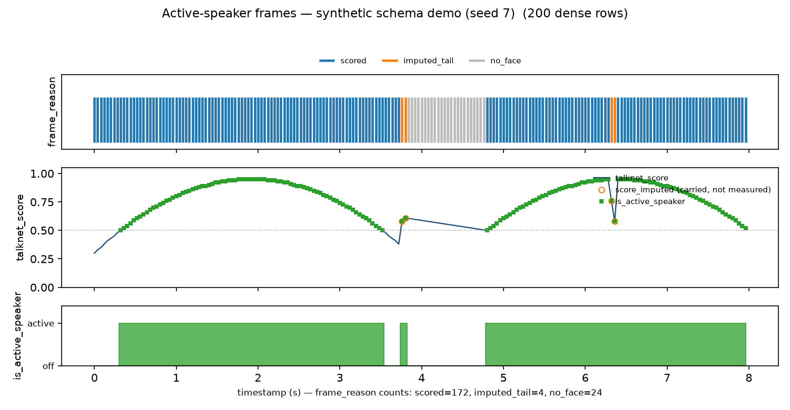

# Modality semantics

Interpret each model's answer in its own scope. Diarization, face activity, person
tracks and narrative candidates are different kinds of evidence, not interchangeable
identities or ground truth.

Back to the overview: [Storytel Pipeline](../README.md).

## Contents

- [Speech and language](#speech-and-language)
- [Acoustics](#acoustics)
- [Active-speaker evidence](#active-speaker-evidence)
- [Pose coordinates](#pose-coordinates)
- [Person tracks](#person-tracks)
- [Story candidates](#story-candidates)

## Speech and language

WhisperX produces segments, words and alignment states. `speaker_assignment` applies
Nemotron speaker labels to the normalized transcript; original WhisperX bytes remain
in `speech/raw/`. Word confidence and segment confidence are not interchangeable:
segment scores can be negative because they are log-probability-derived.

Nemotron is the only diarizer (`diarization_nemotron`). It writes
`speech/speaker_turns_nemotron.parquet`, whose `speaker_id` values (`speaker_0`) are its
own arrival-ordered namespace. Its channels overlap, so a turn records
`diarization_type: overlapping` and the seconds it overlaps another speaker in `overlap_s`.
It uses a whole-clip offline route with at most eight channels; its threshold controls
which frame probabilities become intervals.

Assignment is by maximum overlap, aggregated per speaker: a transcript interval that two
speakers talk over goes to whoever covers most of it, with a deterministic tie break, and
the runner-up is recorded in `runner_up_speaker_id`. There is no exclusive timeline to
prefer. A channel is not proof of a distinct real person: two channels can be one voice
bleeding, and an off-screen speaker can own a channel no face matches.

`speaker_assignment` is the only stage that decides what `speaker_id` means, so it never
leaves another engine's labels behind. A turn table already in the dataset is used even
when `diarization_nemotron` was not re-run (its environment missing, or switched off);
without one, `segments` and `words` are rewritten with `speaker_id: null` and
`speaker_assignment_method: no_diarization` — a recorded fact, not a gap. Transcripts
produced under the removed pyannote engine therefore lose their `SPEAKER_00` labels on
the next run instead of publishing a speaker no table in the dataset contains. It labels
whichever of the two transcript tables the dataset has, so a words-only dataset is not
left publishing a foreign label. The preserved raw WhisperX document is never rewritten.

That makes the turn table an input worth checking, and a damaged one **fails** the stage
rather than clearing labels: a table that is unreadable, lacks `start_time`/`end_time`/
`speaker_id`, holds a reversed or non-numeric interval, runs past the video's audio, names
another `video_id`, or was diarized from a different `audio_sha256` (Nemotron's sidecar
records it) is a defect, and labelling from it would silently mislabel or null everything.
Only genuine absence clears.

English translation is **segment-level translation**, not transliteration or
interlinear glossing. Source and English spaCy annotations are separate. Their
alignment/model-capability fields distinguish token timings, approximate timings
and segment context; model choice does not establish annotation correctness.
See [language policy](configuration.md#language-policy).

## Acoustics

Parselmouth/Praat writes frame pitch, intensity, voicing and formants, plus
segment aggregates and pauses. The frame grid follows `acoustic.time_step`, not
video FPS. Unvoiced pitch is missing, not 0 Hz. Pitch/formant ranges, chunk size
and pause thresholds affect results and belong to recorded configuration.

Read aggregate columns with their producer's denominator. In particular, reported
`duration` is media duration, not automatically a segment span; pause statistics
must not be reinterpreted as a different denominator. Dense numerical analysis
belongs in Parquet; ELAN bins are summaries, not substitutes for measurements.

## Active-speaker evidence

TalkNet connects audio with **one selected visible face per working-grid frame**.
A face's inactivity does not establish global silence or exclude an off-screen voice.
Scores are unbounded logit-like values, not probabilities.

| Field | Meaning |
|---|---|
| `face_status = no_face` | No face located |
| `face_status = tracked` | A located face with a usable score |
| `face_status = tracked_unscored` | Face located but no usable measurement |
| `score_imputed = true` | Last measured score carried over at most two tail frames |
| `frame_reason` | Why a measurement, carry or missing score exists |

The closed reason set is `scored`, `imputed_tail`, `no_face`, `score_not_finite`,
`track_has_no_scores`, `past_scored_tail`, `tail_score_not_finite`, and `unknown`.
`unknown` supports older raw artifacts whose cause cannot be reconstructed.
An imputed score is not a new measurement, even if smoothing changes its displayed
value. Unscored rows retain null scores rather than becoming zero-confidence faces.

The dense table follows a 25 FPS **working grid**, not source frames. Use the
[dataset clock rules](datasets.md#consumer-rules) before joining it to pose.

`activespeaker.write_video` optionally retains the native 25 FPS AVI with audio:
all tracked-face boxes and native smoothed scores (green at score ≥ 0, red otherwise).
These overlays are not the normalized table's scene-clipped smoothing, configurable
threshold and selected-face hysteresis. An unscored overlay is not evidence of silence.

## Pose coordinates

OpenPose publishes body, hand and face keypoints in source pixels. Confidence is
per keypoint; missing or partially detected landmarks are normal. Rendered skeleton
images are optional views and can be downscaled without rescaling table coordinates.

`pose_normalized` writes a **separate** body-centred table. The default origin is
`MidHip`, the first axis points to `Neck`, and the second is its clockwise
perpendicular in image coordinates. The origin becomes `(0, 0)` and basis joint
`(1, 0)`. This is a change of basis, not replacement of measured pixels.

`basis_state` distinguishes missing joints, a degenerate basis and non-finite math;
`value_status` describes each keypoint. Missing coordinates remain null, not zeros.

Reference fixtures from R's `multimolang::dfMaker` are committed under
[`tests/fixtures/pose_normalized/`](../tests/fixtures/pose_normalized).

## Person tracks

YOLO/ByteTrack IDs are trajectories, **not a count of unique humans**. Cuts,
occlusion and tracker association can split one person into many IDs or merge
tracks. Read frame count, confidence, coverage and gaps before quoting a count.
`longest_gap_seconds` is elapsed time between sightings, including sampling
spacing; it is not measured duration of absence.

The default is `yolo11n.pt` with ByteTrack. Raw output records model path/hash,
tracker and settings. An explicitly configured missing weights location is refused
rather than silently replaced with a download. With no explicit location, model
resolution can download weights. Changing the tracker can change counts more than
changing checkpoint size; neither default claims optimal accuracy.

The detection table contains sightings, not a complete sampled/empty-frame grid.
An absent detection cannot prove that frame was inspected. YOLO person IDs, OpenPose
per-frame person indices and TalkNet face tracks cannot be equated by matching digits.

## Story candidates

The `stories` stage asks an LLM for narrative windows in the source transcript.
Rows retain model/prompt/request identity, times and JSON-encoded evidence segment
IDs. IDs are namespaced by request window; parent links remain inside that namespace.
Out-of-window evidence, invalid boundaries and broken parent relationships are
rejected/countable rather than promoted to valid claims.

An empty answer with `no_story_reason` is legitimate and retained in raw response
metadata; a video with no transcript segments skips the stage. A story whose evidence
crosses request-window boundaries can be dropped, so absence is not a recall result.
Raw responses and cache entries make claims auditable; low temperature alone does
not make service responses deterministic.

There is no validated ground truth or accuracy guarantee here. **Story candidates
are not exported as an ELAN tier**. Transcript evidence supports auditing a claim,
not treating the LLM's title/confidence as a measurement of narrative truth.
