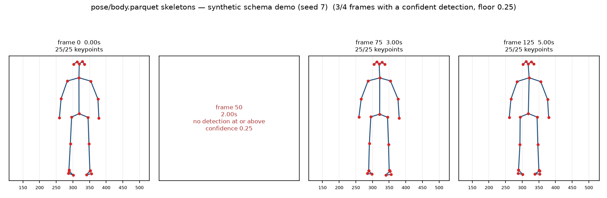

# Modality semantics

Interpret each model's answer in its own scope. Diarization, face activity, person
tracks and narrative candidates are different kinds of evidence, not interchangeable
identities or ground truth.

Back to the overview: [Storytel Pipeline](../README.md).

## Contents

- [Speech and language](#speech-and-language)
- [Acoustics](#acoustics)
- [Active-speaker evidence](#active-speaker-evidence)
- [Audio–visual agreement](#audiovisual-agreement)
- [Pose coordinates](#pose-coordinates)
- [Person tracks](#person-tracks)
- [Storytelling events and stories](#storytelling-events-and-stories)

## Speech and language

WhisperX produces segments, words and alignment states. `speaker_assignment` applies
pyannote speaker labels to the normalized transcript; original WhisperX bytes remain
in `speech/raw/`. Word confidence and segment confidence are not interchangeable:
segment scores can be negative because they are log-probability-derived.

pyannote and Nemotron analyze the same audio independently. Transcript assignment
uses **pyannote only**. The default pyannote alignment timeline is exclusive;
Nemotron supports overlap, with `diarization_type` and `overlap_s` recording that
semantics. Nemotron uses a whole-clip offline route with at most eight channels;
its threshold controls which frame probabilities become intervals.

Compare engines by time overlap, never matching speaker digits. A second channel
is not proof of a second real person. Enabling Nemotron does not relabel existing
transcript rows; choosing it for assignment would be a separate behavior change.

English translation is **segment-level translation**, not transliteration or
interlinear glossing. Source and English spaCy annotations are separate. Their
alignment/model-capability fields distinguish token timings, approximate timings
and segment context; model choice does not establish annotation correctness.
See [language policy](configuration.md#language-policy).

## Acoustics

Parselmouth/Praat writes frame pitch, intensity, voicing and formants, plus
segment aggregates and pauses. The frame grid follows `acoustic.time_step`, not
video FPS. Unvoiced pitch is missing, not 0 Hz. Pitch/formant ranges, chunk size
and pause thresholds affect results and belong to recorded configuration.

Read aggregate columns with their producer's denominator. In particular, reported
`duration` is media duration, not automatically a segment span; pause statistics
must not be reinterpreted as a different denominator. Dense numerical analysis
belongs in Parquet; ELAN bins are summaries, not substitutes for measurements.

## Active-speaker evidence

TalkNet connects audio with **one selected visible face per working-grid frame**.
A face's inactivity does not establish global silence or exclude an off-screen voice.
Scores are unbounded logit-like values, not probabilities.

| Field | Meaning |
|---|---|
| `face_status = no_face` | No face located |
| `face_status = tracked` | A located face with a usable score |
| `face_status = tracked_unscored` | Face located but no usable measurement |
| `score_imputed = true` | Last measured score carried over at most two tail frames |
| `frame_reason` | Why a measurement, carry or missing score exists |

The closed reason set is `scored`, `imputed_tail`, `no_face`, `score_not_finite`,
`track_has_no_scores`, `past_scored_tail`, `tail_score_not_finite`, and `unknown`.
`unknown` supports older raw artifacts whose cause cannot be reconstructed.
An imputed score is not a new measurement, even if smoothing changes its displayed
value. Unscored rows retain null scores rather than becoming zero-confidence faces.

The dense table follows a 25 FPS **working grid**, not source frames. Use the
[dataset clock rules](datasets.md#consumer-rules) before joining it to pose.

`activespeaker.write_video` optionally retains the native 25 FPS AVI with audio:
all tracked-face boxes and native smoothed scores (green at score ≥ 0, red otherwise).
These overlays are not the normalized table's scene-clipped smoothing, configurable
threshold and selected-face hysteresis. An unscored overlay is not evidence of silence.

## Audio–visual agreement

`speaker_fusion` adds evidence beside each selected diarizer's turns; it does not
replace diarization or transcript speaker labels. Each engine has its own fusion
file. Fusion `face_track_id` links to TalkNet's track, not a voice identity.

| `agreement` | Reading |
|---|---|
| `face_matched` | A track clears minimum active-frame and active-ratio requirements |
| `face_partial` | A best track exists but misses a requirement |
| `no_face_visible` | Measured rows in the turn contain no located face |
| `face_never_active` | Located face evidence contains no active frame |
| `no_frames_measured` | No ASD row covers the turn; not a claim of absence |

Read `agreement_detail` and counts before the verdict. The invariant is
`face_active_frames <= face_frames_in_turn <= frames_in_turn`; the winning track's
active ratio is not a share of the entire audio interval. Face presence can include
unscored evidence, so inspect score/reason fields before concluding a face was
measured inactive. Missing selected-engine input can skip that engine; no fusible
engine or no ASD input skips the stage. An actually failed producer can also block
it through the DAG; absence and failure are different.

## Pose coordinates

OpenPose publishes body, hand and face keypoints in source pixels. Confidence is
per keypoint; missing or partially detected landmarks are normal. Rendered skeleton
images are optional views and can be downscaled without rescaling table coordinates.

`pose_normalized` writes a **separate** body-centred table. The default origin is
`MidHip`, the first axis points to `Neck`, and the second is its clockwise
perpendicular in image coordinates. The origin becomes `(0, 0)` and basis joint
`(1, 0)`. This is a change of basis, not replacement of measured pixels.

`basis_state` distinguishes missing joints, a degenerate basis and non-finite math;
`value_status` describes each keypoint. Missing coordinates remain null, not zeros.

Reference fixtures from R's `multimolang::dfMaker` are committed under
[`tests/fixtures/pose_normalized/`](../tests/fixtures/pose_normalized).

## Person tracks

YOLO/ByteTrack IDs are trajectories, **not a count of unique humans**. Cuts,
occlusion and tracker association can split one person into many IDs or merge
tracks. Read frame count, confidence, coverage and gaps before quoting a count.
`longest_gap_seconds` is elapsed time between sightings, including sampling
spacing; it is not measured duration of absence.

The default is `yolo11n.pt` with ByteTrack. Raw output records model path/hash,
tracker and settings. An explicitly configured missing weights location is refused
rather than silently replaced with a download. With no explicit location, model
resolution can download weights. Changing the tracker can change counts more than
changing checkpoint size; neither default claims optimal accuracy.

The detection table contains sightings, not a complete sampled/empty-frame grid.
An absent detection cannot prove that frame was inspected. YOLO person IDs, OpenPose
per-frame person indices and TalkNet face tracks cannot be equated by matching digits.

## Storytelling events and stories

The `stories` stage asks an LLM to mark **storytelling events** (the conversational
activity of launching and telling: pre-telling, telling, coda) and, **separately**,
the **stories** told inside them (the represented "what"), plus spans it could not
place. The three tables are `storytelling_events`, `stories` and `uncertain_spans`;
a story names its event, and one event may carry several stories.

The model cites a `segment_id` and copies a `transcript_quote` from that one segment;
it never reports times. The pipeline locates the quote in
`speech/segments.parquet` and maps its **first and last word** to times through
`speech/words.parquet`, recording `*_time_precision` as `word` or, when the edge word
has no exact alignment, `segment` — it never borrows a neighbouring word's time. A
quote must cover whole words, so a one-letter quote cannot land inside a longer word;
it must also occur exactly once in the cited segment, because a repeated quote does
not say where the boundary is. An invented segment id, a quote that is not verbatim
or is ambiguous, an enum value outside the closed vocabularies, a duplicate id, a
story outside its event, inconsistent `story_ids`, a missing or blank `story_evidence`
explanation, an `evidence_segment_ids` list that is empty or outside the story's own
span, or a reference to a segment the prompt did not show rejects the whole answer and
the batch is retried. `story_evidence` carries the model's short explanations of why
the stretch is a story; the segments those explanations rest on are in
`evidence_segment_ids`.

The prompt shows each segment in three lines — `segment_id`/`start`/`end`, then the
segment's own `text:`, then its `speakers:` runs — and quotes are copied from `text:`
only. Speaker labels beside each word come from automatic diarization — Nemotron by
default — and are rendered as `[speaker_0] words … [unknown] words` runs.
`stories.speaker_source` selects `nemotron`, `pyannote` or `none`. Nemotron's turns
overlap, so a word is attributed only when one speaker covers at least
`stories.speaker_min_coverage` of it — measured as the union of that speaker's turns,
so being diarized twice over one instant is not two instants — and no other covers at
least `stories.speaker_max_competing`; otherwise it is `unknown`. A selected source
with nothing to read (no Nemotron turns, or pyannote labels absent from both word rows
and segments) labels everything `unknown` and is recorded in `stories_summary.json` as
`speaker_source_requested`/`speaker_source_used: none`; the stage never falls back to
the other engine. A label the answer names must be one the rendered prompt showed,
including labels that appear only in the context segments. Labels are arbitrary ids,
not identities.

Empty arrays are a legitimate, expected answer and are counted per window; a video
with no transcript segments skips the stage. The default is the whole transcript in
one request; setting `stories.max_segments_per_request` restores windowing. An event
whose boundary — or whose marked interruption — straddles a window is dropped and
counted **once**, with the number of stories it took with it counted separately
(`dropped_outside_window`, `dropped_stories_outside_window`), so absence is not a
recall result; references to the visible context segments are evidence, not a reason to
reject the answer. Raw responses and cache entries make claims auditable: the raw
window is the endpoint's exact bytes, every rejected attempt is kept beside it under
`stories/raw/rejected/`, and a cache entry keyed by the rendered prompt and posted
request body (so `extra_body` and prompt changes both invalidate it) is reused only
with the response text that produced it. Validation checks the three tables' columns
against their schemas and that every `request_key` in them still has its raw window
file. Low temperature alone does not make service responses deterministic.

There is no validated ground truth or accuracy guarantee here. **Storytelling events
and stories are not exported as an ELAN tier**. Transcript evidence supports auditing
a claim, not treating the LLM's summary or confidence as a measurement of narrative
truth.
